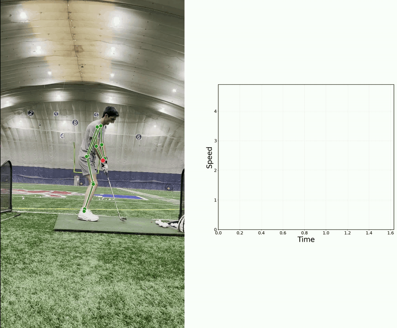
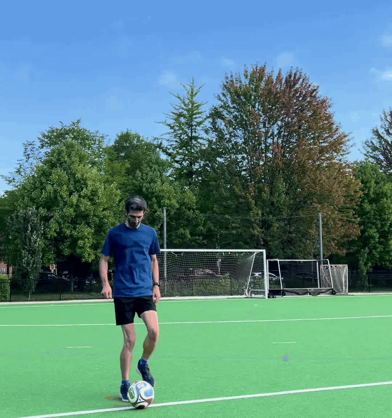

# Computer Vision for Sports

## Golf Swing
RT-DETR finds the golfer and ViTPose estimates the body joints. The right wrist's position and speed (normalized by torso length) are plotted.

  
   
  Wrist motion tracking in the golf swing

## Soccer
RT-DETR detects the ball in each frame, and its path over the last second is drawn as a trail behind it.

  
   
  Soccer ball tracking

